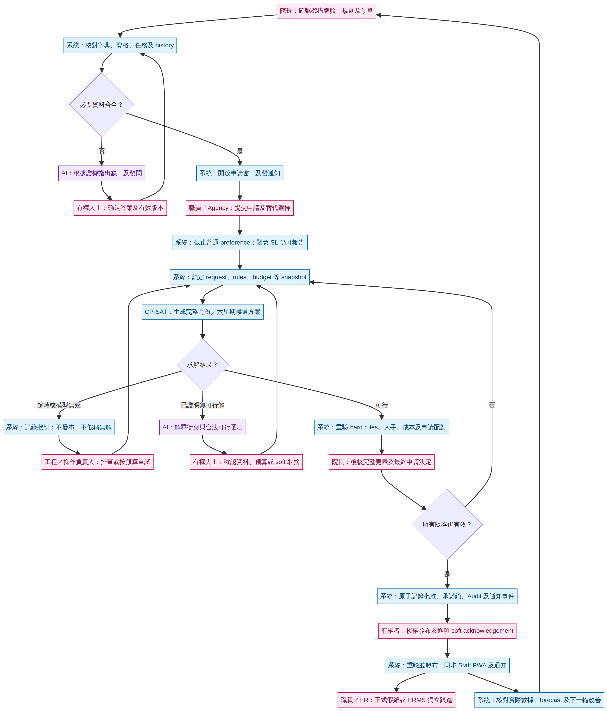

# Emma 完整排更流程與人機分工

你講嘅 domain，核心係「院舍實際運作流程」，唔係 DNS 網域。網址、CORS 及登入影響網站接駁；真正令系統識得編更嘅，係已確認嘅職位資格、更碼、工時、任務、人手、預算、申請及批核權限。

Staff PWA 應同 manager website、FastAPI 放喺同一個 MVP repository，但分成獨立 `staff-pwa/`、管理端 `src/`、後端 `emma-ai-app/`。共用已批准嘅 API／資料契約，唔係共用 service-role key 或登入 token。今次建立嘅係候選分支整合，唔代表正式後端已部署。

## 一條完整閉環

**確認機構規則及預算 → 開放申請 → 截止及鎖定輸入版本 → CP-SAT 生成完整方案 → 系統重驗規則／預算／人手 → 院長覆核方案及申請 → 系統可靠記錄批准與鎖 → 授權發布 → Staff PWA 同步及通知 → HR 表格／HRMS 跟進 → 實際數據回饋下一輪。**

最重要係「配對成功 ≠ 已批准」。例如同事申請 1 月 8 日 DO，系統方案安排咗休班，審批中心應顯示「方案已配對、待批准」，而唔係直接顯示已批准。院長確認完整方案及申請後，先產生真正批准記錄、鎖定承諾、同步 PWA 及發通知。之後如果同事仍需交假紙／HRMS，應顯示另一個待辦狀態，唔可以話 HR 已完成。

## 1. 人先確認政策，系统之後不用每次問

人要確認機構牌照類型、職位資格、各級更碼及工時、日期／時段人手、活動及工作要求、預算／外購費率、請假優先次序及批核權限。同一個 A1，喺救世軍及 NAAC，甚至不同職系，都可能意思不同；資料必須按機構、院舍、單位、職系及字典版本分開。

一旦某規則已獲正確授權並有有效日期，系統之後按該版本自動執行。只有新規則、矛盾、缺資料、超預算或需要政策例外，先重新問人。不能將推測出來嘅習慣，自動變成 hard rule。

## 2. 預算係真正可使用餘額，不是職位空缺直接變更數

每個月先計已批准人力預算，再扣固定薪酬承諾、適用僱主成本、已承諾 OT、已訂外購及預留金額；避免重複扣數，先得到可再訂外購嘅餘額。

你嘅例子 5.5 個空缺 × HK$20,000 = HK$110,000，可以係預算估算，但「110 更」暗含每更 HK$1,000。N 更較貴、PH 倍計、不同職級及更長度費率不同，唔可以一律當成 110 更能力。實際模型要用已確認費率及日期逐更計價。NAAC 六星期跨兩個月時，費用要落返相應服務日期嘅月份，唔可以只對一個六星期總數。

若不足以符合人手／任務 hard rules，系統應提出合法可行選項，例如確認額外外購預算或重新安排可改日期嘅活動；唔可以自動削走法定最低人手。你提出 CW A1–7／P1–5 加 B/D，應係「what-if 方案」，先核對時段、工作、資格、總費用及人手，再由有權者採納。

## 3. N／AN、申請窗口及 Agency

「先排 N／AN」可以成為模型安排優先層，但唔應將一個未核證嘅局部更表永久鎖死。已批准嘅指定安排係 hard；普通輪次公平性可以係 soft／排序目標。每日 3 AN、每人每月 2 次及「6 日排好」需要確認定義；31 日月有 93 次每日分配，唔能夠全部以每人正好 2 次配平。

25 號開放、10 號截止，要先明確係收集邊個目標月份嘅申請及確切香港時間。開放、提醒、截止應由後端有紀錄嘅工作執行，PWA 顯示相同狀態；關閉只限制適用嘅普通 preference，緊急 SL 報告不能一併停用。4 個 preferred duty／DO 要按已確認計數方式執行，唔代表所有 AL／SL 都只可填 4 個。

Agency 每更提供 2–3 個選擇，係替代選項，唔係已訂 2–3 更。系統要同時核对資格、可用時段、實際訂位及費率，最後只選可承諾嘅方案。

## 4. CP-SAT 真正要一齊計嘅內容

輸入完整月份或六星期，包括跨期休息／DO、已批准假期與鎖、待批申請、各時段 resident counts、人手／資格、活動／工作、已確認費率及預算、職員工時與已確認歷史模式。

模型先確保法律、资格、重疊／休息、已批准承諾、各時段人手、必做任務及已批准 hard budget。再於可行範圍內滿足申請、公平分配、更表穩定性、減少 OT／外購等。若你要 AL > PH > medical FU > CL > ordinary duty 嘅真正優先次序，應使用分層優化，唔係隨意細權重累加，令好多低優先申請抵銷一個高優先申請。[1]

救世軍 East／West 嘅 RN／HW／CW／AW 數目係機構要求，不應標示成 SWD 法定比例；A／P 時段、夜間要求，以及「+1」係額外加人定從 base 抽調，要有確認。同一個人喺同一時間不能既當 East 又當 West，亦不能一面全數當 base coverage，一面外出／上堂／做另一個不能兼做嘅工作。

CP-SAT 顯示 FEASIBLE 只代表可行，唔一定最優；UNKNOWN／超時唔代表證明無解。系統應顯示已支持嘅 hard rules、仍欠規則、完整性及方案差異，唔可以用「100%」掩蓋未建好嘅約束。[2]

## 5. 過往 12 個月不是直接餵 AI，更不是已經有齊

現時可見 NAAC shared files 只有兩個 sample，未能證明有完整、連續、已匯入嘅 12 個月。要先建立來源、有效更碼版本、日期覆蓋、缺漏、重疊及修訂紀錄。亦不能由 planned roster 推斷真實出勤、薪酬、能力或拒絕申請紀錄。

History 可以分析夜更分配、跨期負擔、已記錄申請滿足率、外購／OT 趨勢及活動時段模式。比較應按有資格職員、可用機會及周期長度標準化；六星期不能直接對一個月總次數。資料不足時仍可按已確認 rules 編更，但 history／forecast 信心要誠實顯示。

Forecast 應比較「規則-only 基線」及「history-assisted」方案，再用按時間分割嘅回測檢查，而唔係用將來資料去預測过去。可提出更有效調配及減少外購／行政重排，但未量度前不能承諾減省幾多員工，更不會自動作裁員或健康／績效診斷。

## 6. AI 問人；人決定後系統續做

系統先產生可核對嘅阻礙證據，例如某日少一個合资格 HW、已批准 AL 導致不可補位、Agency cap 不足。AI 只解釋同一份證據、顯示合法選項及提出清楚問題，唔會自己批准更改 hard rule。

問題要指定有權者、影響嘅方案版本、可選答案及有效期。答案經真正身份／權限驗證後，寫成新規則／預算版本，系統自動重新 snapshot、solve、check。私人聊天一句模糊答案唔應直接改正式更表；同一份問題已有有效答案，就唔需要每輪再問。

一般月份保留院長對完整更表／申請嘅最終批核；如果將來要減少這個 HITL，必須由院長明確授權特定政策及界限。你今次最新流程不等於授權 blanket 自動批假；PR10 現時亦只係 policy／evaluation foundation。

## 7. Compliance Q&A

Q&A 要先識別 RCHE／RCHD 牌照類別、有效日期法例、住客數、批准時段及職位註冊資格，再解釋相關條文、所需人數、此更表實際合資格人數及受影響日期／格。法律最低要求、機構較高要求及活動額外要求要分開。

2026 政府公布咗護理保健師職級及部分計算基礎修訂，所以舊 Code／Q1 Demo 表不應作為「最新完整要求」嘅唯一來源；最終職級替代方式要核對最新有效 Schedule 1，不可以一律當成 RN。[3] 沒有牌照／最新 source 時，Q&A 應指出欠資料及需要有權人士核對，唔可以憑一個 ratio 宣稱整間院舍已符合法例。

## 8. NAAC 要獨立處理及提前

NAAC 必須保存 42 日周期、18-sheet 格式及逐日期更碼／工時。帶 # 嘅適用 duty，翌日係**下一個 calendar day 的 Day Off**，包括月底、年末及六星期最後一日嘅 successor-period obligation。不能當通用夜更休息，更不能把工作代號 # 與更碼 # 混在一起。

每職系夜更、資格及 tasks 要由已確認 source／Queenie 規則決定，未答嘅人數／代替／兼做規則唔可以猜。申請、cutoff、agency 及發布應根據周期開始日向前計，唔照抄救世軍月度 25／10。讀入、生成及下載都要用真 18-sheet roundtrip 驗證，而不只是有一粒下載掣。

完整工程契約、狀態機及目前 source 缺口會附在同 repo 文件；設計內容不是已上線聲明。

## References

[1]: https://developers.google.com/optimization/scheduling/employee_scheduling "Google OR-Tools employee scheduling with preference objectives"
[2]: https://developers.google.com/optimization/cp/cp_solver "Google OR-Tools CP-SAT solve statuses"
[3]: https://www.info.gov.hk/gia/general/202606/05/P2026060500319.htm "Hong Kong Government 2026 care-home regulation amendments announcement"
